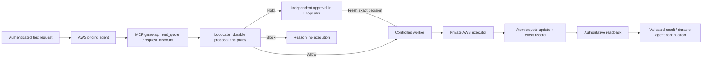

# AWS connector: discovery to a controlled pricing action

Date: October 14, 2026. Status: researched execution plan, not an implementation or deployment receipt. Owner: LoopLabs engineering. This is the active breakdown for the AWS core path; it refines the larger milestones in AWS_PRICING_SLACK_PILOT_PLAN.md. Multi-agent expansion is deferred to MULTI_AGENT_EXPANSION_PLAN.md. Finish the separate wording change before enabling new product surfaces.

## Ownership and active milestone

The external workflow is independently owned and deployed by Raj/Claude. Do not copy its workflow into LoopLabs or take ownership of its hardening. The active LoopLabs-only implementation and exact evidence are in [LIVE_AGENT_CONNECTION_MILESTONE.md](LIVE_AGENT_CONNECTION_MILESTONE.md). Earlier sandbox/executor deployment steps below describe external prerequisites or isolated adapter fixtures, not a requirement to rebuild the customer workflow. Metadata synchronization, observation and enforcement are distinct acceptance boundaries.

## Selected external-workflow candidate

Raj supplied [playground PR 38](https://github.com/fetchsandbox/playground/pull/38). Review at pinned head `bf49e06f0693de2bf989c63563c1cda1aad2b5db` found an existing Gmail/Slack/HubSpot quote agent to reuse instead of implementing a duplicate. Its original 39 mocked-provider tests passed locally; six additional LoopLabs acceptance probes failed. See [the review and revised integration slices](AWS_QUOTE_AGENT_PR38_REVIEW.md). No AWS deployment, tool discovery or LoopLabs enforcement exists in that PR yet. Treat it as a custom external agent until its actual AWS runtime and interfaces are installed and verified.

## Bounded outcome

Import one real AWS agent, show its observed identity and declared tools, and control one sandbox quote change through LoopLabs. A permitted request executes automatically; an exception waits for an independent named decision; a forbidden request never writes. Verify the stored AWS outcome before returning a success output to the agent. Existing sample workflows stay installed and unchanged.

First use an authenticated direct invocation, not Slack, to prove the AWS connector. Slack triggers and Slack approval are separate follow-on releases. No live CRM, customer email, refund, arbitrary workflow reconstruction, parallel branches or multi-agent delegation in this pilot.

## Customer-triggered acceptance clarification

The final acceptance is a real externally triggered AWS journey, not a manual replay of LoopLabs buttons. Raj acts as the customer in a dedicated Slack test conversation first: “I received quote Q-100; can you give me a 14% discount?” A signed event starts the AWS agent, which reads enrolled customer/quote context through its tools, proposes the exact change to LoopLabs, waits for an independent decision if required, and continues automatically to a verified output and explicit run outcome. Email is an additional ingress adapter after the first Slack path, not a requirement to build two triggers simultaneously. An authenticated direct invocation remains an engineering diagnostic, not final trigger acceptance.

The 10% automatic threshold is the agreed example: 14% must be held. A customer message is untrusted request content, never a grant of authority. Ambiguous quote references, ambiguous percentages, missing identity or unsupported actions require clarification or refusal; the model must not invent a record or permission. Customer identity matching and the member who approves are distinct.

Import existing AWS runtime/tools/metadata where the supported interfaces expose them. Import does not reconstruct hidden workflow logic or grant write authority. Display reviewed runtime-to-tool bindings and observed traces; descriptions and tool schemas are untrusted metadata. If an existing workflow lacks the required hooks, document the specific adaptation rather than claim a no-change import. Reuse an existing suitable runtime, or create the isolated pilot runtime; final native-agent checks execute there, not in a local workflow simulator.

Reuse current action authorization, persistence, leases, exact approvals and reconciliation through compatible adapters. Current discount and connector contracts contain domain-specific fields, and the workflow service contains fixed-plan assumptions. Do not relabel them generic or duplicate them as a new pricing engine. Add reusable typed action/adapter boundaries only where required; keep tool payload schemas, business thresholds and trigger configuration outside shared transition logic. Distinguish action state from aggregate run outcome: held is waiting; completed requires every mandatory effect/output verified; blocked/rejected/failed/uncertain must remain distinct, with in-flight work reconciled before presenting a final stopped outcome.

The source inspected has HubSpot labels in prepared sample scenarios; that is not evidence of live onboarding. Confirm actual installed bindings and credentials privately before calling HubSpot connected. If unavailable, show the customer-system boundary as simulated and keep native-HubSpot acceptance pending.

Required scenario tests include 5% allowed, 14% held then approved, explicit rejection, above-hard-limit blocked, malformed/ambiguous trigger, duplicate trigger, forged caller, source/policy drift, expired approval, containment, write-response loss, restart, duplicate continuation and invalid output. Assert state transitions and real external effects separately; never infer a whole-run completion from one succeeded action. Retain current sample regressions. No current state-machine capability is claimed by this planning document alone.

## Research findings and implications

| AWS surface | Published contract | LoopLabs implication |
| --- | --- | --- |
| Runtime inventory | ListAgentRuntimes and GetAgentRuntime expose provider identity, runtime version, name/description, execution role, workload identity and protocol/configuration fields | Extend the current collector with a strict metadata allowlist. Do not ingest environment variables, raw credentials or arbitrary configuration. Metadata does not prove effective IAM permissions. [Runtime API](https://docs.aws.amazon.com/bedrock-agentcore-control/latest/APIReference/API_GetAgentRuntime.html) |
| Gateway inventory | Gateway targets describe backend type, name, description, configuration and synchronization state | Collect supported target metadata separately. Do not infer that every tool in an account or shared gateway belongs to a selected agent. [Target API](https://docs.aws.amazon.com/bedrock-agentcore-control/latest/APIReference/API_GetGatewayTarget.html) |
| Tool discovery | MCP aggregation provides tools/list across configured MCP targets | Fetch names, descriptions and input schemas; preserve pagination, caller scope, timestamps and descriptor hashes. An HTTP runtime is not automatically an MCP tool catalog. [Gateway concepts](https://docs.aws.amazon.com/bedrock-agentcore/latest/devguide/gateway-core-concepts.html) |
| Runtime protocols | HTTP, MCP and other runtime contracts have different discovery mechanisms | Detect the actual deployment before selecting an adapter. A generic HTTP runtime needs an explicit reviewed tool binding or supported manifest; absence stays unknown. [Service contract](https://docs.aws.amazon.com/bedrock-agentcore/latest/devguide/runtime-service-contract.html) |
| Gateway interception | Request interceptors can validate before forwarding or return a response immediately; response interceptors can transform returned content | A future interceptor can participate in enforcement. It is not an hours-long approval wait or an authoritative external effect check. [Interceptor types](https://docs.aws.amazon.com/bedrock-agentcore/latest/devguide/gateway-interceptors-types.html) |
| Runtime gateway target | HTTP runtime targets do not aggregate tool capabilities; documented streaming interceptor limitations differ from buffered requests | Do not confuse fronting an agent invocation with controlling all internal tool calls. Choose the MCP tool boundary explicitly. [Runtime targets](https://docs.aws.amazon.com/bedrock-agentcore/latest/devguide/gateway-target-http-runtime.html) |
| Sandbox state | DynamoDB supports transactional writes and conditional checks | Proposed storage: atomically update one quote version and create an action-effect record. Use a durable action key plus payload binding; do not rely solely on the API's time-bounded request-token deduplication. [Transactions](https://docs.aws.amazon.com/amazondynamodb/latest/developerguide/transaction-apis.html) |

These are design findings from primary documentation, not observed behavior in Raj's AWS account. Region availability, account resources, quotas, network access, SDK versions and current spend remain to be checked. AWS IAM and business discount authority are separate.

## Proposed first installation

Reuse a suitable existing agent after read-only inspection. If none has the needed interface, deploy one dedicated pricing agent on AgentCore Runtime in us-west-2 within the previously authorized $20 incremental test budget. Do not alter an existing Ember or customer agent to force compatibility. If a model is used, pin a supported Bedrock model and cap calls; deterministic policy remains outside the model. A deterministic adapter fixture alone is not native-agent acceptance. Check the current runtime build/architecture contract before selecting an image or build runner.

The agent sees two declared tools:

- `read_quote`: reads the one enrolled sandbox quote.
- `request_discount`: submits the exact desired percentage, expected quote version and business reason. Its description explicitly states that it proposes a change and can return pending, blocked or verified outcome. It cannot directly write.

An AgentCore MCP gateway exposes those tools through dedicated proposal/read targets. The proposal target authenticates to the existing LoopLabs action boundary using a separately enrolled workload identity. Identity is derived from verified configuration, never a model-supplied agent ID. The exact AWS-to-LoopLabs credential handoff and rotation are an explicit contract milestone, not an assumed feature.

The controlled LoopLabs worker alone may invoke a private `apply_discount` executor. That executor has narrowly scoped quote/effect write permission. The agent and proposal gateway role cannot invoke it, write the table or assume the executor role. The executor validates the enrolled destination, immutable action/payload binding and dispatch authority; IAM invocation permission alone is not business approval. All externally exposed URLs/endpoints come from reviewed server configuration, not imported descriptions.

Do not leave a gateway invocation open while a human decides. Save the pending action and continuation correlation. The pilot agent must implement a versioned continuation endpoint that can reload saved task context after a fresh invocation; an AWS session ID alone is not durable application memory. Reuse existing orchestration/outbox interfaces where compatible, and add a distinct AWS adapter rather than passing AWS work through a provider-twin contract.

## Micro milestones and deployment boundaries

Every row is independently reviewable. A deployment is a small pilot rollout after that row's required checks pass, not permission to enable later rows. No row is currently accepted as implemented by this plan.

| ID | One deliverable | Deployment boundary | Acceptance / stop condition |
| --- | --- | --- | --- |
| A0 | Read-only account and code fit check | No deployment | Identify actual service (AgentCore, Bedrock Agents, EC2/custom), runtime/protocol/version, gateway association evidence, available model and remaining budget. Empty inventory is not import proof. Select reuse or dedicated pilot. |
| A1 | Versioned pilot contract and resource plan | No deployment | Fix two tool schemas, request/result envelopes, principal mapping, quote/effect schema, IAM matrix, limits, cleanup list and recovery rules. Review current interface compatibility. |
| A2 | Dedicated sandbox record and private executor | AWS pilot resources only; no agent write path enabled | Conditional update + effect record commit together; same action/same payload returns prior effect; changed payload, stale source and unauthorized invocation fail. Readback finds exact effect. |
| A3 | Read-only runtime discovery | Pilot connector flag; no execution | One actual AWS runtime appears with observed version/identity/name. Cross-account mismatch, revoked/expired discovery access and incomplete pagination remain explicit failures/partial scans. |
| A4 | Tool metadata collection | Pilot catalog flag; no execution | Actual tools/list metadata appears with provenance and reviewed agent-to-gateway binding. Missing/truncated/unsupported schemas, foreign endpoints and descriptor drift do not enable execution. Duplicate names are namespaced. |
| A5 | Connected onboarding | Pilot enrollment flag; no execution | Friendly name/description, generated stable ID, named owner, selected tools and explicit limits. Repeat import deduplicates; new runtime/tool revision requires review. Import remains visibly unverified. |
| A6 | Agent proposal and policy path | Proposal-only AWS gateway target + LoopLabs adapter | A real runtime calls request_discount. Exact action is persisted once. With configured 10% automatic / 50% hard-limit pilot rules, 5% allows, 14% holds, 70% blocks. The hard limit remains a pilot assumption for owner review. No held/blocked quote writes. Reject forged identity and duplicate/malformed requests. |
| A7 | Allowed-action execution | Enable only automatic allowed pilot actions | Worker rechecks current authorization and invokes enrolled executor. Agent cannot invoke executor, mutate the quote or assume the worker role. One action yields one independently read effect. Containment blocks new dispatch. |
| A8 | Held-action approval and automatic continuation | Enable held pilot actions through existing named web approval | Different authorized member approves exact action; worker resumes without manual Execute. Wrong reviewer, self-approval, expiration and source/policy drift refuse execution. Restart while waiting preserves state. |
| A9 | Output and recovery | Enable verified continuation to the pilot agent | Bound result schema/size; no credentials or unapproved fields returned. Success requires authoritative readback. Inject lost response, worker crashes and repeated continuation: no duplicate quote effect; ambiguous outcomes stay uncertain. Agent continuation reloads persisted context. |
| A10 | Readable run and dogfood release | Invited pilot workspace on existing deployment | Show request, agent/tools, reason, decision, approval, actual change and output without copying UUIDs. Raj requests; Pratibha reviews (or reverse), then replay allow/hold/block/recovery. Existing sample pricing smoke checks pass independently. |
| A11 | Slack trigger | Separate Slack pilot release | Signed event in one dedicated channel produces one durable request across retries; reject foreign workspace/channel and unauthorized senders. Existing web pilot remains usable. |
| A12 | Slack approval | Separate Slack pilot release | Signed callback mapped to named member; exact/expiring independent decision; repeat, stale and forged callbacks refused. Approved request continues automatically through the already proved AWS path. |

A0-A5 prove discovery/enrollment only. A6 proves proposals/policy only. Claim controlled execution only after A7's bypass checks. Claim the automatic approval journey only after A8-A10 pass. Slack is not required to accept the first AWS connector.

## Verification and rollout discipline

- During implementation, run changed-module and affected-page tests with meaningful negative cases. Runtime/IAM/execution changes also require the relevant database, adapter, installed-worker and real AWS contract checks. A passing fixture is not real AWS acceptance.
- Each milestone receipt records source commit, tested artifact, scope, exact checks and failures, AWS resource/configuration revision, deployed version, remaining unknowns and cleanup/rollback result. Private identifiers stay in private receipts; no credentials or prospect data in Git.
- Preserve the current pricing demonstration. Use an isolated enrollment, sandbox record and feature flags, append-only migrations if needed, a scoped executor stop switch and a per-release rollback. Turning a flag off stops new work; it does not undo a committed quote update.
- Before provisioning, check region support, quotas and current spend against the existing $20 authorization. Configure application limits and tags/cleanup tracking. Cost alerts can lag and are not a hard spending cap; pause before estimated authorized spend would be exceeded.
- Do not bundle the independent UI release optimization into this connector. Existing deployment checks remain as actually implemented; any fast UI path gets its own reviewed classification and evidence.

## Future expansion

Parallel branches, shared multi-agent budgets, delegated identities, arbitrary graph joins and framework-wide adapters are future work in MULTI_AGENT_EXPANSION_PLAN.md. This connector establishes one controlled tool path, not universal control of every AWS agent.
