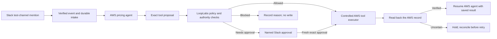

# AWS pricing agent controlled through LoopLabs

Status: proposed next workflow. October 14, 2026. Finish the wording pass first. This plan does not enable a cloud connector, change the current sample workflow, provision resources, or send Slack messages.

The active AWS implementation breakdown is [AWS_CONNECTOR_MICRO_MILESTONES.md](AWS_CONNECTOR_MICRO_MILESTONES.md): prove the AWS core with direct authenticated invocation and existing web approval before separate Slack releases. Its proposal-only `request_discount` tool and private `apply_discount` executor refine the earlier generic `set_discount` naming below. Multi-agent expansion is deferred in [MULTI_AGENT_EXPANSION_PLAN.md](MULTI_AGENT_EXPANSION_PLAN.md).

## Intended experience

An administrator connects one AWS scope, selects one deployed agent, reviews its observed identity and declared tools, and assigns accountable ownership and LoopLabs rules. The administrator edits a friendly name and description; the server creates a stable internal ID. Provider identifiers remain available under technical details.

A mention in one dedicated Slack test channel starts a pricing request. The AWS agent proposes an exact quote change. LoopLabs evaluates the request outside the model. Permitted work proceeds automatically. An exception waits for a named Slack approval; a blocked request cannot be approved. The approved action executes in AWS and is read back before the workflow continues. The control plane shows the trigger, agent, rule, decision, execution and observed result together.

Start with one tool, `set_discount`, and one AWS sandbox quote record. Customer email, refunds, broad channel monitoring and additional clouds are later extensions. Do not replace the currently installed sample pricing demonstration.

Discovery, enrollment and enforcement are separate. A discovered runtime or a declared tool list does not establish effective IAM authority or prove that tool calls cannot bypass LoopLabs.

## Reuse and measured gaps

| Existing area | Reuse | Extension required |
| --- | --- | --- |
| AWS discovery and inventory | `lib/workspace/cloud-discovery.ts`, `cloud-inventory.ts`, `cloud-aws-cli.ts` and reviewed bindings | Read one actual runtime and its version; add supported gateway/tool descriptors without inferring unavailable metadata |
| Owner review | Existing cloud owner-review records and named member model | Bind reviewed ownership to the imported resource and revision |
| Agent registration | Existing profiles, name, owner, capabilities and request allowance | Server-generated IDs, description, unique provider identity mapping and explicit revision review; append-only migration if needed |
| Policy and approval | Existing exact-payload/version/source checks and independent named decisions | A versioned AWS pricing contract and current Slack-to-member mapping; do not pretend AWS IAM contains business discount limits |
| Execution and reconciliation | Existing controlled provider interfaces, action IDs, outbox/leases and verification patterns | A real AWS adapter with conditional write and authoritative effect lookup; no adapter relabeled as a provider twin |
| Durable waiting | Existing pluggable orchestration boundary and Temporal-backed outbox | Persist Slack waits and AWS continuation correlation; no open HTTP request or sleeping runtime while waiting for a person |
| Product experience | Generic navigation and decision terminology | Connected onboarding, readable agent/tool catalog and one correlated run detail |

The current discovery store explicitly marks effective permissions and declared tools as unknown. Import must preserve that distinction until additional evidence is collected. Tool descriptions are descriptive metadata, never grants of authority.

## Milestones

| Milestone | Small deliverables | Acceptance evidence |
| --- | --- | --- |
| 0. Contract and isolated pilot | Inspect existing AWS resources/account, remaining authorized $20 test budget and current source; select one runtime, record and Slack channel; document supported tool schema and stop conditions | Written scope and current resource inventory; no claim that an empty scan proves agent import |
| 1. Connected onboarding | Connect → discover → select → review identity/tools → assign owner → import. Friendly name/description editable; stable server ID hidden from routine editing | One real AWS agent imported; repeat import deduplicates; missing principal/tool metadata remains unknown; changing provider revision requires review |
| 2. Controlled AWS tool | Implement one versioned pricing adapter against a dedicated AWS sandbox record, with expected version, stable action key and readback | One authorized conditional update; duplicate, stale version, altered payload and missing authority refused; direct mutation by the agent role denied |
| 3. Automatic message intake | Verify a bot mention from a dedicated Slack channel; persist event and correlation before acknowledging; invoke the imported AWS agent to propose a typed action | One event creates one request across Slack retries; bot/self messages, foreign workspace/channel and invalid signatures are refused; no broad message ingestion |
| 4. Slack approval and continuation | Show what changes, why review is required, rule/version, reviewer and expiry. Approve/Reject buttons bind to the saved action, not editable message text | Wrong reviewer, requester self-approval, expired approval, changed source/policy, duplicate callback and forged callback refused; valid approval schedules exactly the saved action |
| 5. Automatic AWS execution and result | Worker dispatches the approved action, verifies its AWS effect, then sends a durable continuation to the AWS agent | Restart while waiting, restart after approval, lost response, duplicate dispatch and duplicate continuation preserve one observed change; uncertain outcomes remain held |
| 6. Readable control-plane run | One timeline for trigger → proposal → policy → approval → execution → verification, with output and next step | Raj and Pratibha can trace one request without copying UUIDs or manually driving each action; historical success is separate from current state |
| 7. Isolated deployment and dogfooding | Feature-flagged pilot alongside existing examples; tagged test resources; rollback/containment and cost monitoring | Existing sample pricing smoke checks still pass; real AWS/Slack acceptance receipts; no claim of enterprise readiness beyond the measured pilot |

Each milestone remains partial until every listed acceptance check passes. No estimate or morning completion promise is made before milestone 0 establishes the actual runtime, tools and Slack installation.

## Authority and reliability rules

- Separate imported observations, declared tool schemas, reviewed ownership, LoopLabs business policy and verified enforcement. Display their provenance and time.
- Review a policy in the pilot workspace. Existing sample thresholds (automatic up to 15%, approval through 50%, block above 50%) are an illustrative starting point, not an AWS-derived rule or a change to production policy.
- Preserve the existing principle that agents propose/read, while a controlled worker executes. After approval the worker invokes the scoped AWS adapter; the AWS agent resumes with the verified result. Do not grant an agent general execution/approval authority to make continuation convenient.
- The agent's AWS role must lack direct access to mutate the sandbox quote. Only the controlled executor role may write that resource. Restrict alternate roles/credentials and verify a direct-bypass attempt; a sidecar or SDK hook alone is insufficient.
- Bind decisions to workspace, exact action/payload, agent/runtime revision, tool/destination, policy version, source record version, current authority and expiry. Revocation or change requires fresh work.
- Use a signed Slack request, current workspace/channel and named-user mapping. A Slack reaction or text saying “approved” is not an approval. A signature proves origin, not approver authorization.
- Acknowledge Slack promptly after verified durable intake; process asynchronously. Deduplicate events and button callbacks. Use a notification outbox so failures cannot lose a held action.
- Slack approval is not proof of AWS execution. Worker dispatch is not proof of the effect. Verify AWS state before marking completion or allowing dependent output.
- A lost response stays uncertain. Readback must find the exact effect or prove safe absence; otherwise contain. Never blindly replay a discount.
- Keep raw credentials out of the browser, Git, Slack and receipts. Request only minimal Slack scopes and a dedicated test channel. Store private configuration using existing protected deployment mechanisms.
- Reuse the existing AWS account/server where suitable. Check spending against the already authorized $20 incremental test budget before provisioning. No additional server or broad IAM grant is assumed.

## Test and dogfood sequence

Use synthetic quotes and a dedicated Slack test channel, with a named requester and a different named approver. Test automatic 5%, held 25%, and blocked 70% under the explicitly configured illustrative 15%/50% policy. Then alter the quote while approval is pending, expire/revoke approval, reject a request, replay a Slack event/callback, stop the worker before/after a write, and interrupt the acknowledgement. Save distinct receipts for each case; no composite pass hides a failure.

Dogfooding should require only a Slack request and, when needed, one Slack approval. The control plane is for reviewing the agent, rules, progress and result. A separate advanced manual control remains diagnostic rather than the normal workflow.

Before external actions, required configuration is the AWS account/region/runtime (or approval to create the dedicated test agent within the existing budget), a Slack workspace/test channel, app installation and two named identities. Do not ask for passwords or tokens in chat. This is a later setup task, not a request to disturb the current deployment.

## Fast UI release path

The owner authorized affected-page checks for UI-only work and not waiting for duplicate hosted checks after measured local checks pass. The current pre-push and control-demo deployment scripts still invoke the full suite, so the fast path is not yet implemented.

Create a separate, fail-closed UI release classification:

1. Text/presentation-only edits: review the exact diff, test affected pages and negative/loading states, run lint/types and a production build, inspect desktop/mobile presentation and links, then validate the deployed pages.
2. Paths alone are insufficient. Changes to event handlers, requests, approval eligibility, policy/state logic, schemas, provider/worker routing, dependencies, configuration, or release/security scripts require their relevant behavior suites and real contracts.
3. Unknown classification uses the broader path. The classifier cannot approve changes to itself or silently label failed gates as passes.
4. Publish a receipt stating exactly which checks ran and which were not required by the approved UI scope. Existing failed or historical receipts remain intact.
5. Keep immutable images, the existing deployment/rollback mechanism and production browser verification. Avoid restarting workers or changing provider authority for a wording patch.

This is a proposed release workflow, not permission to mark the existing failed full-quality result as passed or claim the pipeline is already optimized.

## Primary references checked October 14, 2026

- [AWS AgentCore runtime metadata](https://docs.aws.amazon.com/cli/latest/reference/bedrock-agentcore-control/get-agent-runtime.html)
- [AgentCore gateway concepts and tool discovery](https://docs.aws.amazon.com/bedrock-agentcore/latest/devguide/gateway-core-concepts.html)
- [AgentCore inbound and outbound authorization](https://docs.aws.amazon.com/bedrock-agentcore/latest/devguide/runtime-oauth.html)
- [Gateway runtime-target authorization](https://docs.aws.amazon.com/bedrock-agentcore/latest/devguide/gateway-target-http-runtime.html)
- [Slack request verification](https://docs.slack.dev/authentication/verifying-requests-from-slack)
- [Slack interaction handling](https://docs.slack.dev/interactivity/handling-user-interaction/)

These sources support the integration design. They do not establish that LoopLabs has implemented or passed the proposed pilot.
